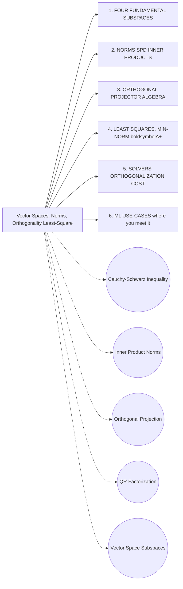

# Cheatsheet — Vector Spaces, Norms, Orthogonality & Least-Squares Projections

> [!summary] 10-Second Visual Hook
> Every vector splits into an in-subspace shadow $\hat{\boldsymbol{b}}$ and a perpendicular residual $\boldsymbol{e}\perp W$

- **Full Monograph:** [[Vector Spaces, Norms, Orthogonality & Least-Squares Projections]]
- **Sub-Topic MOC:** [[ST 01 - Vector Spaces, Spectral Theory & Matrix Factorizations]]
- **Atomic Concepts:** [[Cauchy-Schwarz Inequality]], [[Inner Product & Norms]], [[Orthogonal Projection]], [[QR Factorization]], [[Vector Space & Subspaces]]

## Interactive Mindmap Overview

## Branch Summary & Key Equations

- **1. FOUR FUNDAMENTAL SUBSPACES**
  $$
  \mathbb{R}^n = \mathrm{Row}(\boldsymbol{A}) \oplus \mathrm{null}(\boldsymbol{A})
  $$
- **2. NORMS & SPD INNER PRODUCTS**
  $$
  \langle \boldsymbol{x}, \boldsymbol{y} \rangle_{\boldsymbol{M}} = \boldsymbol{x}^{\top}\boldsymbol{M}\boldsymbol{y} (\boldsymbol{M}\succ\boldsymbol{0})
  $$
- **3. ORTHOGONAL PROJECTOR ALGEBRA**
  $$
  \boldsymbol{P}_W = \boldsymbol{B}(\boldsymbol{B}^{\top}\boldsymbol{B})^{-1}\boldsymbol{B}^{\top} = \boldsymbol{Q}\boldsymbol{Q}^{\top} \quad (\boldsymbol{Q}^{\top}\boldsymbol{Q}=\boldsymbol{I}_r)
  $$
- **4. LEAST SQUARES, MIN-NORM & \boldsymbol{A}^{+}**
- **5. SOLVERS & ORTHOGONALIZATION COST**
- **6. ML USE-CASES — where you meet it**

## Related Sources

[[Source - Deep Learning]], [[Source - E D I T I O N]], [[Source - Machine Learning co ban]], [[Source - Mathematics for Machine Learning]], [[Source - Probabilistic Machine Learning]]
