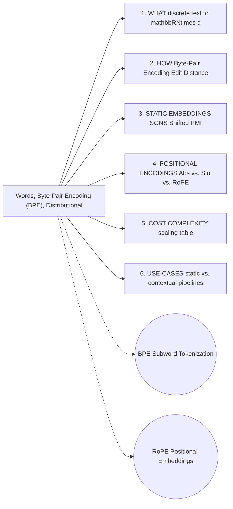

# Cheatsheet — Words, Byte-Pair Encoding (BPE), Distributional Embeddings & Positional Encodings

> [!summary] 10-Second Visual Hook
> Slice raw bytes into subwords $\cdot$ embed meaning as directions $\cdot$ rotate by position

- **Full Monograph:** [[Words, Byte-Pair Encoding (BPE), Distributional Embeddings & Positional Encodings]]
- **Sub-Topic MOC:** [[ST 05 - Subword Tokenization & Vector Semantics]]
- **Atomic Concepts:** [[BPE & Subword Tokenization]], [[RoPE & Positional Embeddings]]

## Interactive Mindmap Overview

## Branch Summary & Key Equations

- **1. WHAT — discrete text to $\mathbb{R}^{N\times d}$**
  $$
  \boldsymbol{X}_0 = \boldsymbol{E}_{\boldsymbol{w}} + \boldsymbol{P}_{1:N} \in \mathbb{R}^{N\times d}
  $$
- **2. HOW — Byte-Pair Encoding & Edit Distance**
  $$
  (a^*,b^*) = \arg\max_{(a,b)}\sum_{s\in\mathcal{C}_{\mathrm{pre}}} f(s) \mathrm{count}(ab\text{ in }s)
  $$
- **3. STATIC EMBEDDINGS — SGNS & Shifted PMI**
  $$
  \mathcal{L}_{\mathrm{SGNS}} = -\log\sigma(\boldsymbol{c}_{\mathrm{pos}}^{\top}\boldsymbol{w}) - \sum_{i=1}^k\log\sigma(-\boldsymbol{c}_{\mathrm{neg},i}^{\top}\boldsymbol{w})
  $$
- **4. POSITIONAL ENCODINGS — Abs vs. Sin vs. RoPE**
  $$
  \tilde{\boldsymbol{q}}_m^{\top}\tilde{\boldsymbol{k}}_n = (\boldsymbol{R}_{\Theta,m}^{d_h}\boldsymbol{q}_m)^{\top}(\boldsymbol{R}_{\Theta,n}^{d_h}\boldsymbol{k}_n) = \boldsymbol{q}_m^{\top}\boldsymbol{R}_{\Theta,n-m}^{d_h}\boldsymbol{k}_n
  $$
- **5. COST & COMPLEXITY — scaling table**
- **6. USE-CASES — static vs. contextual pipelines**

## Related Sources

[[Source - Build a Large Language Model (From Scratch) (for sam speaks)]], [[Source - Probabilistic Machine Learning]], [[Source - Speech and Language Processing]]
